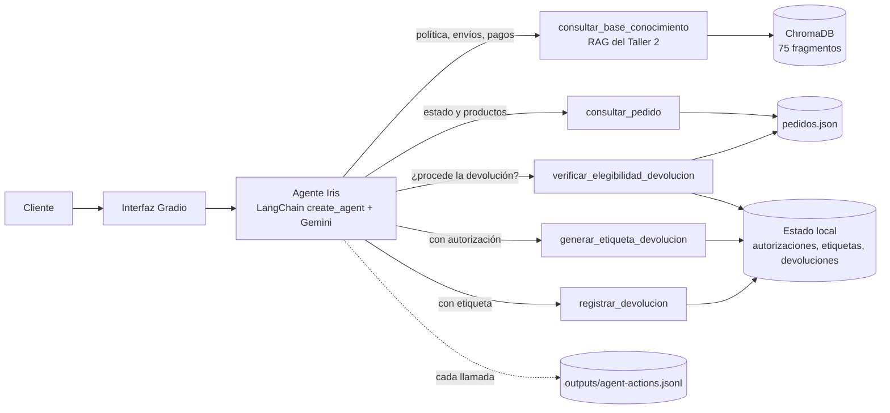
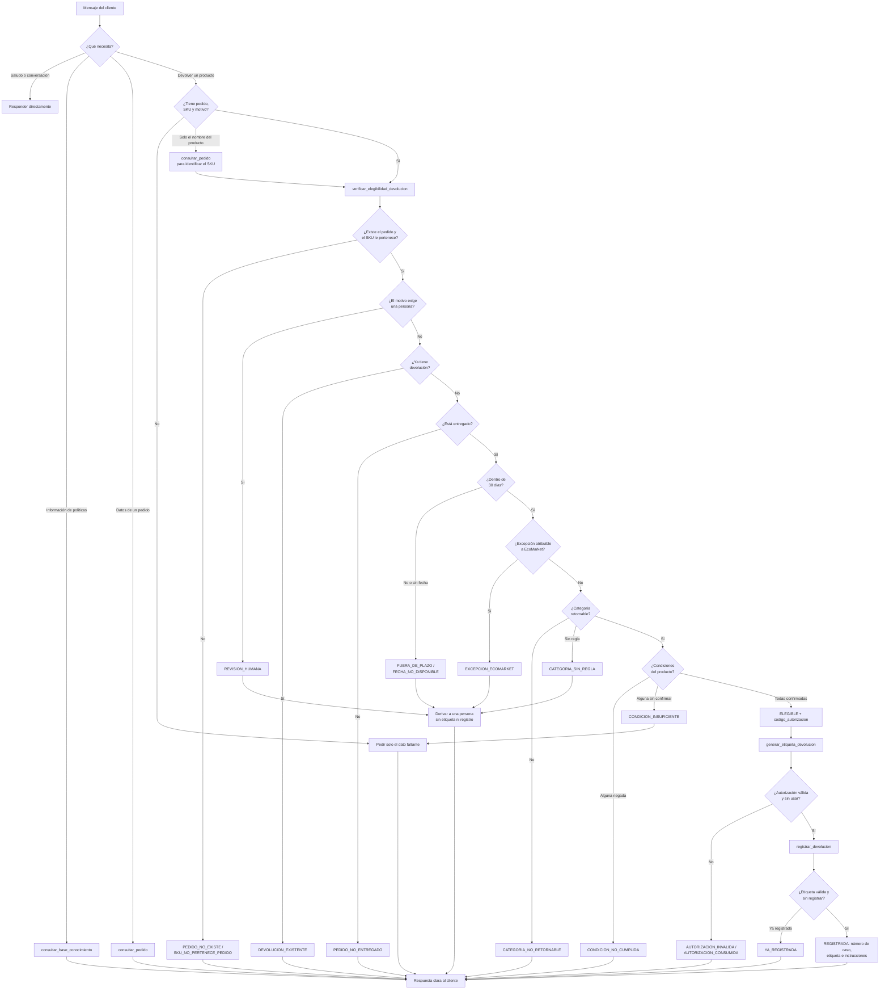

# Fase 1 · Diseño de la arquitectura del agente

**Caso:** automatización del proceso de devoluciones de EcoMarket con un agente de IA
**Autores:** William Alberto Suaza · Anderson Trujillo · Bairon Gutiérrez

---

## 1. Punto de partida

En el Taller 1 construimos a Iris, la asistente de atención al cliente de EcoMarket, y en el Taller 2
le dimos un sistema RAG: los pedidos se consultan por coincidencia exacta del número de seguimiento y
el resto del conocimiento de la empresa se recupera de ChromaDB en dos etapas (20 candidatos con
`multilingual-e5-base` y reranking con `bge-reranker-v2-m3` para quedarnos con los cuatro mejores).

Iris respondía, pero no actuaba. Si un cliente pedía devolver un producto, le explicaba la política y
el proceso quedaba en sus manos. En este proyecto Iris pasa a ser un agente: decide qué consultar,
verifica si la devolución procede, genera la etiqueta de retorno y registra el caso. El trabajo del
Taller 2 no se reemplaza; se convierte en una de las herramientas del agente.

## 2. Cómo se incorpora el RAG

Teníamos dos maneras de combinar el RAG con el agente:

| Opción | Cómo funciona | Ventaja | Desventaja |
|---|---|---|---|
| Arquitectura *router* | Una regla de entrada clasifica el mensaje y lo envía al RAG o al agente | Una consulta informativa cuesta una sola llamada al modelo | Los mensajes mixtos («quiero devolver la camiseta, ¿cuánto tarda el reembolso?») obligan a elegir una sola ruta, y cada regla nueva del clasificador es un punto más de fallo |
| **RAG como herramienta** | El agente decide en cada turno si consulta la base de conocimiento, un pedido o las herramientas de devolución | Un mismo turno puede combinar información y acción, y el agente decide con todo el contexto de la conversación | Una consulta informativa cuesta una llamada adicional al modelo |

Elegimos **el RAG como herramienta**. En atención al cliente los mensajes mezclan preguntas y
solicitudes con frecuencia, y un router por reglas tendría que adivinar la intención antes de que el
modelo lea el mensaje. La llamada adicional es un costo aceptable frente a esa rigidez.

## 3. Arquitectura

El modelo decide **qué herramienta usar y con qué argumentos**. Las reglas que permiten o bloquean una
devolución **no quedan a criterio del modelo**: están en `devoluciones.py`, y cada herramienta de
acción exige el resultado de la anterior (la etiqueta exige una autorización y el registro exige una
etiqueta).

## 4. Herramientas

El agente usa cinco herramientas. Una es el RAG del Taller 2 y las otras cuatro interactúan con los
sistemas de pedidos y devoluciones, que en este prototipo son funciones simuladas sobre archivos JSON.

| Herramienta | Tipo | Qué hace |
|---|---|---|
| `consultar_base_conocimiento` | Consulta (RAG) | Responde preguntas informativas con la base de conocimiento |
| `consultar_pedido` | Consulta | Devuelve estado, fecha de entrega y productos de un pedido |
| `verificar_elegibilidad_devolucion` | Decisión | Aplica las reglas de la política y, si procede, emite una autorización |
| `generar_etiqueta_devolucion` | Acción | Genera la etiqueta de retorno a partir de una autorización válida |
| `registrar_devolucion` | Acción | Registra el caso a partir de una etiqueta válida |

Las cuatro herramientas de pedidos y devoluciones devuelven un diccionario con `ok`, `codigo` y, cuando
hay algo que explicar, `mensaje`. El código permite que el agente, el panel de la interfaz y el
registro de acciones distingan el éxito de cada tipo de fallo sin interpretar texto.

### 4.1 `consultar_base_conocimiento`

| Entrada | Salida para el modelo | Salida para el panel |
|---|---|---|
| `consulta` (texto) | Respuesta del RAG y los cuatro fragmentos finales con su fuente | Los 20 candidatos con similitud, los fragmentos con puntaje del reranker y el método de recuperación |

La herramienta usa `response_format="content_and_artifact"`: el modelo recibe solo lo necesario para
responder, y la evidencia completa de la recuperación viaja como *artifact* hacia el panel de
actividad.

### 4.2 `consultar_pedido`

| Entrada | Salida | Códigos |
|---|---|---|
| `numero_pedido` (ECO-AAAA-NNNN) | Estado, fecha de entrega, transportadora, productos (SKU, nombre, categoría) y número de devolución previa | `PEDIDO_ENCONTRADO`, `PEDIDO_NO_EXISTE` |

Le permite a Iris identificar el SKU cuando el cliente nombra el producto, y evita que invente
estados o productos.

### 4.3 `verificar_elegibilidad_devolucion`

**Entrada**

| Parámetro | Tipo | Descripción |
|---|---|---|
| `numero_pedido` | texto | Número de seguimiento |
| `sku` | texto | Producto que se quiere devolver |
| `motivo` | texto | Motivo con las palabras del cliente |
| `sin_uso`, `conserva_etiquetas`, `sin_olores_ni_manchas`, `conserva_empaque`, `accesorios_completos`, `conserva_cables_y_manual`, `sin_marcas_escritura` | booleano opcional | `true` si el cliente lo afirmó, `false` si dijo lo contrario, omitido si no lo mencionó |

Las condiciones son booleanas para que la decisión no dependa de cómo el modelo redacte la descripción
del producto. Cada categoría exige las condiciones de la política:

| Categoría | Condiciones exigidas |
|---|---|
| Hogar | `sin_uso`, `conserva_empaque`, `accesorios_completos` |
| Textiles | `sin_uso`, `conserva_etiquetas`, `sin_olores_ni_manchas` |
| Electrónica | `conserva_empaque`, `conserva_cables_y_manual` (EcoMarket verifica el número de serie al recibir el producto) |
| Papelería y oficina | `sin_uso`, `sin_marcas_escritura` |

**Salida**

| Campo | Contenido |
|---|---|
| `elegible` | Si la devolución ordinaria procede |
| `requiere_agente_humano` | Si el caso debe pasar a una persona |
| `codigo` y `mensaje` | Resultado de la verificación y su explicación |
| `requisitos_faltantes` | Condiciones que el cliente no ha confirmado; Iris debe pedirlas |
| `requisitos_incumplidos` | Condiciones que el cliente negó; la devolución no procede |
| `codigo_autorizacion` | Solo cuando la devolución es elegible |

**Códigos posibles:** `ELEGIBLE`, `PEDIDO_NO_EXISTE`, `SKU_NO_PERTENECE_PEDIDO`, `REVISION_HUMANA`,
`DEVOLUCION_EXISTENTE`, `PEDIDO_NO_ENTREGADO`, `FECHA_NO_DISPONIBLE`, `FUERA_DE_PLAZO`,
`EXCEPCION_ECOMARKET`, `CATEGORIA_NO_RETORNABLE`, `CATEGORIA_SIN_REGLA`, `CONDICION_NO_CUMPLIDA` y
`CONDICION_INSUFICIENTE`.

### 4.4 `generar_etiqueta_devolucion`

| Entrada | Salida | Códigos |
|---|---|---|
| `codigo_autorizacion` emitido por la verificación | Número de caso `DEV-AAAA-NNNN`, número de etiqueta `RET-…`, transportadora e instrucciones | `ETIQUETA_GENERADA`, `ETIQUETA_PENDIENTE_REGISTRO`, `AUTORIZACION_INVALIDA`, `AUTORIZACION_CONSUMIDA`, `ETIQUETA_EXISTENTE` |

No recibe el pedido ni el SKU: solo una autorización emitida por el código, y cada autorización sirve
una sola vez. Aunque el modelo intente generar una etiqueta sin verificar, la herramienta lo rechaza.
Si ya existe una etiqueta sin registrar para el mismo producto, la devuelve en lugar de crear otra.

### 4.5 `registrar_devolucion`

| Entrada | Salida | Códigos |
|---|---|---|
| `numero_etiqueta` | Número de caso, pedido, SKU y estado «Esperando entrega a transportadora» | `REGISTRADA`, `YA_REGISTRADA`, `ETIQUETA_NO_EXISTE` |

Cierra el flujo. Un segundo registro de la misma etiqueta no crea otro caso, y una verificación
posterior del mismo producto devuelve `DEVOLUCION_EXISTENTE`.

## 5. Marco de agentes

Comparamos LangChain y LlamaIndex con los criterios que más pesan en este flujo:

| Criterio | LangChain (`create_agent`) | LlamaIndex (`FunctionAgent`) |
|---|---|---|
| Continuidad con el Taller 2 | La cadena LCEL, `ChatGoogleGenerativeAI` y el índice de ChromaDB se reutilizan sin cambios | Habría que envolver la cadena LCEL o reescribir la recuperación con sus abstracciones |
| Definición de herramientas | `@tool` genera el esquema a partir de la firma y del docstring, incluidos los booleanos opcionales | `FunctionTool.from_defaults` ofrece algo equivalente |
| Control del ciclo | Middleware: `wrap_tool_call` intercepta cada llamada y `ModelCallLimitMiddleware` limita las llamadas al modelo | Se controla desde el *workflow*, con más código propio para auditar cada llamada |
| Separar la evidencia de lo que lee el modelo | `content_and_artifact` en la herramienta | Requiere manejar la salida a mano |
| Pruebas sin API | Un modelo de chat falso permite probar el ciclo completo | Posible, con más preparación |
| Fortaleza principal | Orquestación de herramientas y agentes | Indexación y consulta de documentos |

Elegimos **LangChain**. El agente necesita, sobre todo, orquestar herramientas con controles estrictos,
y ahí LangChain ofrece las piezas exactas: `create_agent` construye el ciclo de *tool calling*, y el
middleware nos deja auditar y acotar ese ciclo sin escribirlo a mano. La fortaleza de LlamaIndex está
en la indexación, que ya resolvimos en el Taller 2 con LangChain y ChromaDB.

## 6. Flujo de trabajo de una devolución

Las decisiones de la parte superior (qué necesita el cliente y si tiene los datos) las toma el
modelo. Los rombos desde `verificar_elegibilidad_devolucion` hacia abajo son reglas del código: el
modelo no puede saltárselas, porque cada herramienta de acción exige la evidencia producida por la
anterior.

## 7. Reparto de responsabilidades

| Lo decide el modelo | Lo decide el código |
|---|---|
| Si el mensaje es un saludo, una consulta o una solicitud de devolución | Si la devolución procede |
| Qué herramienta llamar y en qué orden | Si una autorización es válida y no fue usada |
| Qué condiciones del producto afirmó el cliente | Si una etiqueta o un registro ya existen |
| Qué dato pedir cuando falta información | Cuántas llamadas al modelo se permiten por mensaje |
| Cómo explicar el resultado al cliente | Qué queda registrado en el log de acciones |
